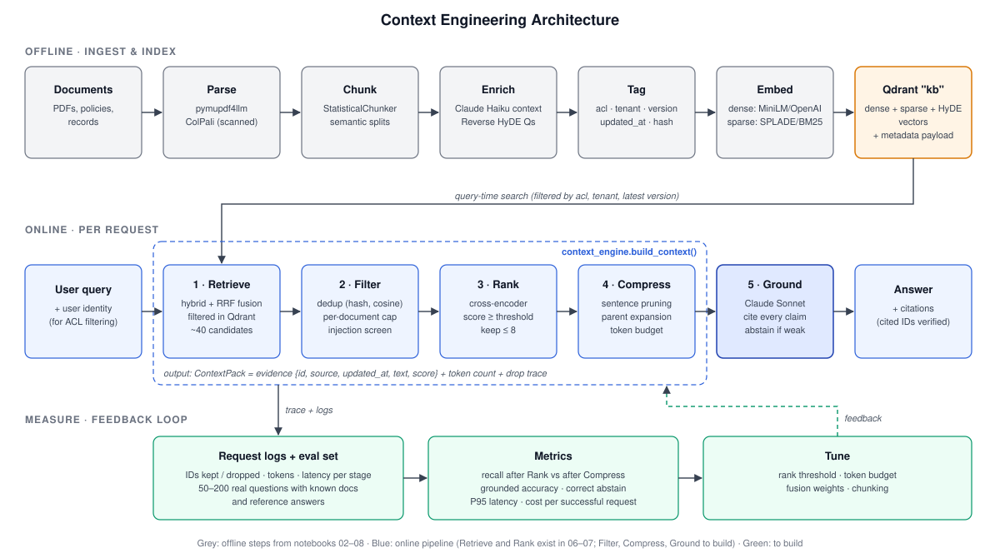

# Context Engineering Stack

How to turn the techniques in this repository into a production context-engineering
pipeline: **Retrieve → Filter → Rank → Compress → Ground → Measure**.

The idea: the model does not need more context, it needs the *right* context.
Every stage below decides what reaches the model, and most stages already exist here
as notebooks. This doc maps each stage to the code we have, picks one default per
stage, and lists what still needs to be built.



---

## 1. Stack at a glance

| Stage | What it does | Already built (notebook) | Production choice | Gap |
|---|---|---|---|---|
| **Ingest** | Parse, chunk, enrich | `03_semantic_chunking`, `04_contextual_retrieval`, `05_reverse_hyde`, `08_multimodal_pdf`, `exercise/02` | `pymupdf4llm` → `StatisticalChunker` → Claude contextual summary (prompt-cached) → Reverse-HyDE questions | Move from notebooks to a batch job; add `source`, `updated_at`, `acl`, `content_hash` metadata |
| **Retrieve** | Gather candidate evidence | `01_simple_rag`, `06_hybrid_search`, `exercise/03` (SPLADE + dense in Qdrant) | **Qdrant** server, named dense + sparse vectors, Query API with server-side fusion | Replace `:memory:` and the manual weighted average |
| **Filter** | Drop irrelevant, outdated, duplicate, unauthorized | `exercise/01` (Qdrant payload filter) | Qdrant payload filters (ACL, tenant, date) at query time + near-duplicate removal after retrieval | Not built: dedup, recency, ACL, prompt-injection screening |
| **Rank** | Pick the strongest evidence | `07_reranking` (cross-encoder), `exercise/03` (Cohere rerank) | `cross-encoder/ms-marco-MiniLM-L-6-v2` locally, or Cohere Rerank as a managed option | Add a score cutoff, not just top-k |
| **Compress** | Fit the budget without losing facts | Parent/neighbour expansion in `exercise/03` (the reverse operation) | Extractive sentence pruning with the same cross-encoder, then a token-budget packer | Not built |
| **Ground** | Evidence-backed answer, or abstain | — | Claude with numbered sources, required citations, an abstain rule | Not built |
| **Measure** | Prove it works | — | Small eval set + per-request telemetry | Not built |

---

## 2. Stage by stage

### Ingest (offline)
Already in the repo:
- **Parsing:** `pymupdf4llm` for text PDFs (`exercise/02`), ColPali + `pdf2image` for
  scanned or visual PDFs (`08`).
- **Chunking:** `semantic_chunkers.StatisticalChunker` with OpenAI
  `text-embedding-3-small` or a HuggingFace encoder (`03`, `exercise/02`).
- **Contextual enrichment:** Claude writes a one-sentence context per chunk, with the
  full document prompt-cached (`04`). This output is `data/corpus.json`.
- **Reverse HyDE:** generate questions each chunk answers and index them alongside it (`05`).

Add for context engineering, as payload on every point:
```json
{ "doc_id": "...", "chunk_id": "...", "parent_id": "...",
  "source": "policy/refunds.pdf", "updated_at": "2026-09-01",
  "version": 3, "acl": ["support", "tenant:acme"],
  "content_hash": "sha1:...", "tokens": 212 }
```
Without these fields, the Filter stage cannot work.

### Retrieve
Today `06_hybrid_search` runs BM25 (`bm25s`) in memory and dense search in Qdrant
separately, then merges them with min-max normalisation and `alpha=0.2`.
`exercise/03` already puts dense and SPLADE (`naver/splade-cocondenser-ensembledistil`)
vectors in a single Qdrant collection.

Production choice: use the `exercise/03` layout in a **persistent Qdrant server**, and
let Qdrant's Query API run both prefetches and fuse them with RRF. That removes the
hand-tuned `alpha` and the per-query score normalisation.

```python
qdrant.query_points(
    collection_name="kb",
    prefetch=[
        models.Prefetch(query=dense_vec,  using="dense",  limit=50, filter=acl_filter),
        models.Prefetch(query=sparse_vec, using="sparse", limit=50, filter=acl_filter),
    ],
    query=models.FusionQuery(fusion=models.Fusion.RRF),
    limit=40,
)
```
Keep the Reverse-HyDE question vectors as a third prefetch when queries are phrased
very differently from the documents.

### Filter
1. **Before retrieval (in Qdrant):** `acl` matches the caller, `tenant` matches,
   and `updated_at` / `version` is the latest for that `doc_id`. Unauthorized content
   never leaves the database. This is what makes it a security control, not just a
   quality one.
2. **After retrieval (in Python):**
   - exact duplicates by `content_hash`;
   - near duplicates by cosine similarity > 0.95 between candidate embeddings
     (`scikit-learn` is already a dependency);
   - keep at most N chunks per `doc_id`, so one long document can't crowd out the rest.
3. **Safety:** strip or flag retrieved text that contains instructions aimed at the
   model (prompt-injection screening) before it is placed in the prompt.

### Rank
`07_reranking` already scores (query, chunk) pairs with
`cross-encoder/ms-marco-MiniLM-L-6-v2`; `exercise/03` uses Cohere `rerank-english-v3.0`.

Production choice: rerank the ~40 fused candidates, then keep chunks **above a score
threshold** (tuned on the eval set), capped at k≈8. A threshold, not a fixed top-k,
makes "no good evidence" visible to the Ground stage.

### Compress
This is the post's main point: send fewer tokens *without dropping the critical fact*.
1. **Extractive pruning:** split each surviving chunk into sentences, score each one
   against the query with the same cross-encoder, and drop low scorers. Always keep
   sentences that contain numbers, dates, or entities named in the query.
2. **Expand when needed:** if a top chunk is cut mid-thought, pull in its parent or its
   neighbours (`exercise/03` already does previous/next page retrieval).
3. **Token budget packer:** fill a fixed budget (e.g. 3–6k tokens) in rank order, then
   put the strongest evidence first and last to avoid the "lost in the middle" effect.
4. **Abstractive summary** with a small model only for long conversation history or
   tool output, never for the policy text the answer will cite.

### Ground
Generation is on `gpt-3.5-turbo` / `gpt-4` in most notebooks, and on Claude in `04`
and `08`. Production choice: **Claude** (`claude-sonnet-5-5` for answers,
`claude-haiku-5-5` for enrichment and compression), with:
- each evidence block numbered and labelled with `source` and `updated_at`;
- a system prompt that requires a citation for every claim and tells the model to
  answer "I don't have enough information" when the evidence doesn't cover the question;
- a post-check that every cited ID exists in the context that was sent;
- prompt caching on the static system prompt and policy blocks (as in `04`).

### Measure
Log per request: query, retrieved IDs, kept IDs, tokens before and after compression,
per-stage latency, and the answer with its citations.

Offline eval set: 50–200 real questions with gold `doc_id`s and reference answers.

| Metric | How |
|---|---|
| Context recall | Gold `doc_id`s present after Rank, and still present after Compress |
| Context precision | Share of kept chunks that are relevant |
| Grounded accuracy | LLM judge: is every claim supported by a cited chunk? |
| Abstain correctness | On unanswerable questions, did it abstain? |
| Tokens, P95 latency | From the request logs |
| Cost per successful request | Total cost ÷ requests judged correct |

The trade-off the post warns about is the gap between recall **after Rank** and recall
**after Compress**: any drop there means compression is losing evidence.

---

## 3. Recommended stack

| Layer | Choice | Status |
|---|---|---|
| Language / runtime | Python 3.12 (CPython) | In use. Note: `.python-version` says `pypy@3.11`, which can't run torch / sentence-transformers |
| Package mgmt | `uv` + `requirements.in` | In use |
| Parsing | `pymupdf4llm`, ColPali + `pdf2image` | In use |
| Chunking | `semantic-chunkers` (StatisticalChunker) | In use |
| Embeddings (dense) | `all-MiniLM-L6-v2` (local) or `text-embedding-3-small` (API) | In use |
| Embeddings (sparse) | SPLADE (`naver/splade-cocondenser-ensembledistil`) or `bm25s` | In use |
| Vector DB | Qdrant (server, named dense + sparse vectors, payload indexes) | In use, in memory only |
| Reranker | `sentence-transformers` CrossEncoder; Cohere Rerank optional | In use |
| LLM | Anthropic Claude (Sonnet for answers, Haiku for enrichment and compression) | Partly in use |
| Serving | FastAPI service exposing `/context` and `/answer` | **To build** |
| Memory | Qdrant collection per user for conversation memory | **To build** |
| Observability | Structured JSON logs (OpenTelemetry later) | **To build** |
| Eval | `pytest` harness + JSONL eval set + LLM judge | **To build** |

---

## 4. Proposed code layout

Pull the notebook logic into a package so each stage can be tested and swapped on its own:

```
context_engine/
  ingest/      parse.py  chunk.py  enrich.py  (contextual, reverse_hyde)  index.py
  retrieve.py  # Qdrant hybrid query with ACL / recency filters
  filter.py    # dedup, per-doc cap, injection screen
  rank.py      # cross-encoder + threshold
  compress.py  # sentence pruning, neighbour expansion, budget packer
  ground.py    # prompt assembly, Claude call, citation check, abstain
  pipeline.py  # build_context(query, user) -> ContextPack; answer(...)
  telemetry.py
  api.py       # FastAPI
eval/
  questions.jsonl
  run_eval.py
```

`ContextPack` is the contract between the stages: a list of evidence items
`{id, source, updated_at, text, score}`, plus a token count and the trace of what each
stage dropped and why.

## 5. Build order

1. Package the existing notebooks (`ingest`, `retrieve`, `rank`) and add the metadata payload.
2. Build the eval set and measure the current baseline.
3. Add Filter and Compress; check that recall holds while tokens go down.
4. Add Ground (citations + abstain) and the FastAPI service.
5. Add telemetry and dashboards; tune thresholds against the eval set.
